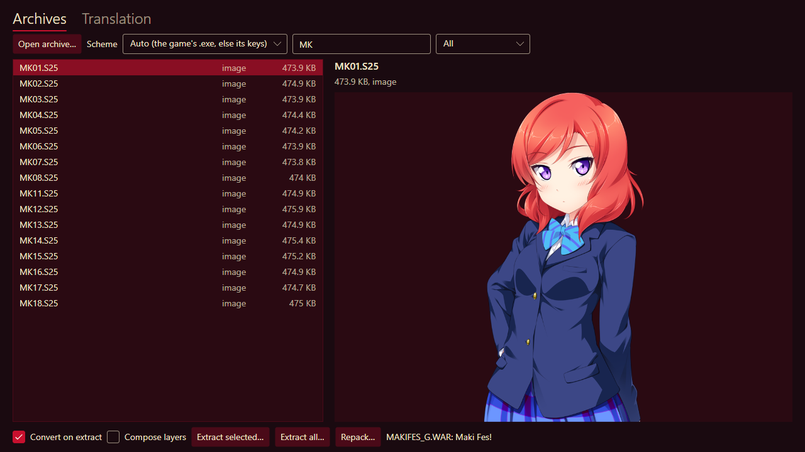
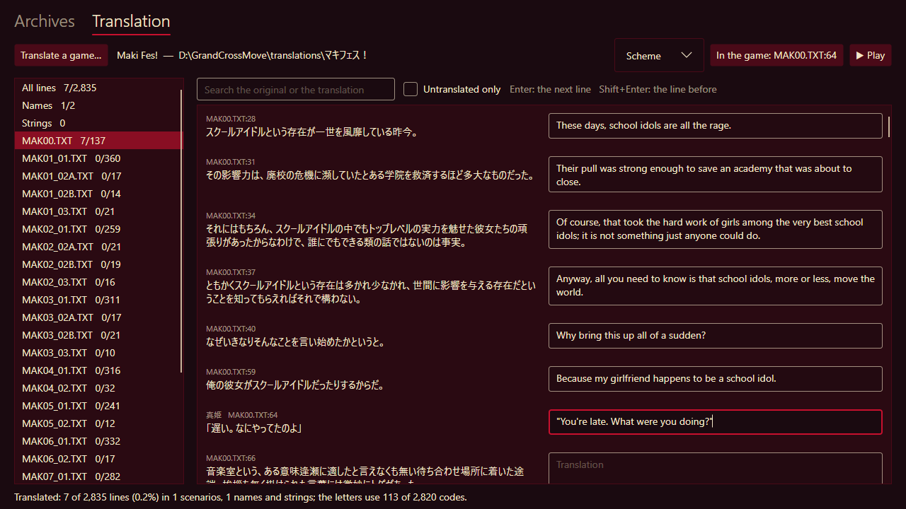
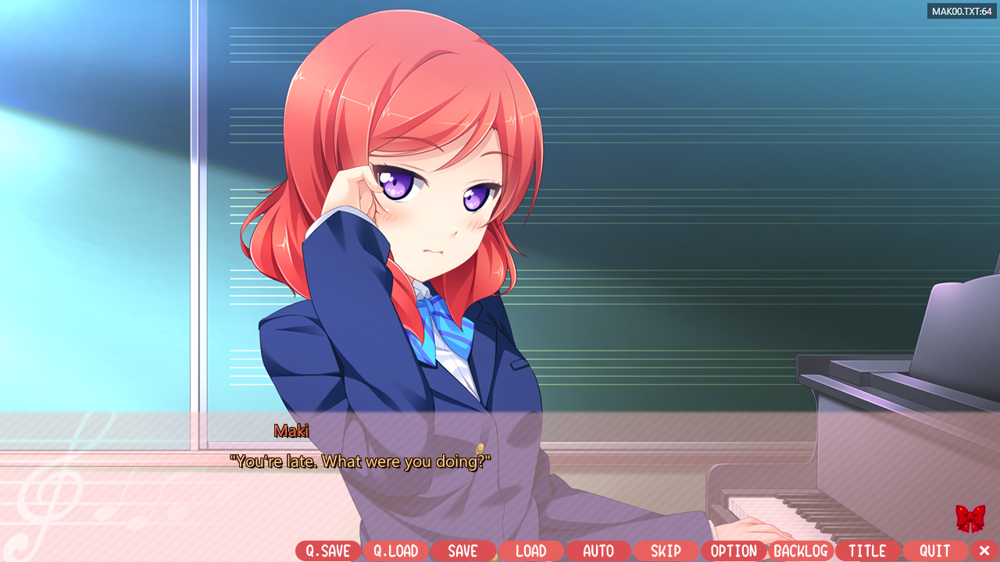

<p align="center">
  <picture>
    <source media="(prefers-color-scheme: dark)" srcset="docs/logo/wordmark-dark.svg">
    
  </picture>
</p>

# OpenShiina

An unofficial, open-source player for visual novels made with the ShiinaRio (椎名里緒) engine.
It reads the game's own files and runs the game's own scripts (the engine's SCN bytecode, with the
x86 code embedded in it), so the title screen, effects, text, menus, saves and settings are the
game's own.

<p align="center">
  
</p>

## Why OpenShiina

The ShiinaRio engine runs only on 32-bit Windows, through old Windows APIs, and some of its games
ask for their disc. OpenShiina keeps these games playable:

- **On today's machines and on phones:** Windows, Linux and Android, from the same game files,
  with no Windows layer or emulator in between.
- **As the games were made:** it runs their own scripts rather than retelling the story, so the
  effects, menus and saves are the original ones.
- **In other languages:** translations sit beside the game and are read as it plays, without
  touching its files.
- **For keeping:** the engine's behaviour is written down in
  [docs/engine-notes.md](docs/engine-notes.md), so these games do not depend on one old executable.

**Status:** early. What changed in each version is in [CHANGELOG.md](CHANGELOG.md), and what is
planned next in [docs/todo.md](docs/todo.md).

You need your own installed copy of the game. OpenShiina contains no game data.

## Games

The games tried so far, on Windows, Linux and Android:

| Game | Japanese title | Year | Engine | Status |
|---|---|---|---|---|
| [Ero-On!](https://vndb.org/v11473) | えろおん！ | 2010 | 2.49 | ✅ Plays through |
| [Azu Plus](https://vndb.org/v7579) | アズプラス | 2010 | 2.47 | ✅ Plays through |
| [Oreimo Plus](https://vndb.org/v6035) | 俺妹プラス | 2010 | 2.47 | ✅ Plays through |
| [Aneiro](https://vndb.org/v6590) | アネイロ | 2011 | 2.49 | ✅ Plays through |
| [Homu☆Plus](https://vndb.org/v8019) | ほむ☆プラス | 2011 | 2.49 | ✅ Plays through |
| [Yuru Plus](https://vndb.org/v10125) | ゆるプラス | 2011 | 2.49 | ✅ Plays through |
| [Sena Plus](https://vndb.org/v10126) | 星奈プラス | 2011 | 2.49 | ✅ Plays through |
| [Kuroneko Plus](https://vndb.org/v10586) | 黒猫プラス | 2012 | 2.49 | ✅ Plays through |
| [Nyaru Plus](https://vndb.org/v10779) | ニャルプラス | 2012 | 2.49 | ✅ Plays through |
| [Rikka Plus](https://vndb.org/v11902) | 六花プラス | 2012 | 2.49 | ✅ Plays through |
| [Maki Fes!](https://vndb.org/v16484) | マキフェス！ | 2014 | 2.50 | ✅ Plays through |
| [Re:Rem Plus](https://vndb.org/v22991) | Re:レムプラス | 2018 | 2.50 | ✅ Plays through |
| [Ao no Juuai](https://vndb.org/v4048) | 青の獣愛 | 2005 | 2.34 | ✅ Plays through |
| [Chuuchuu Nurse](https://vndb.org/v1144) | ちゅうちゅうナース | 2008 | 2.45 | ✅ Plays through |
| [Can Fes!](https://vndb.org/v4143) | きゃん☆フェス！ | 2010 | 2.47 | ✅ Plays through |
| [Bitch Nee-chan ga Seijun na Hazu ga Nai!](https://vndb.org/v18781) | ビッチ姉ちゃんが清純なはずがないっ！ | 2016 | 2.50 | ✅ Plays through |
| [Bitch Shimai ga Seijun na Hazu ga Nai!!](https://vndb.org/v20429) | ビッチ姉妹が清純なはずがないっ！！ | 2017 | 2.50 | ✅ Plays through |
| [Bitch Gakuen ga Seijun na Hazu ga Nai!!?](https://vndb.org/v21429) | ビッチ学園が清純なはずがないっ！！？ | 2017 | 2.50 | ✅ Plays through |
| [Chuuni Hime no Teikoku](https://vndb.org/v17900) | 厨二姫の帝国 | 2018 | 2.50 | ✅ Plays through |
| [Chiccha na Hanayome ~Mada Mada Tsubomi da mon~](https://vndb.org/v20284) | ちっちゃな花嫁 ～まだまだつぼみだもんっ～ | 2017 | 2.50 | ✅ Plays through |

✅ every route was played to its end, or every scenario of the game was run through to its end
by the test runner, nothing stopping ([how](docs/compatibility.md#sweeping)).

OpenShiina has the keys of 116 more ShiinaRio games, not tried yet, and VNDB lists 35 more it
has no keys for. Whether one plays depends on its engine version: 2.45, 2.47, 2.49 and 2.50 run,
and 2.34 (one game of it tried). Every game, with its engine version, and each platform's state
are in [docs/compatibility.md](docs/compatibility.md).

## Screenshots

| | |
|---|---|
|  |  |
| Maki Fes! (GRAND†CROSS, 2014) running its own scripts | Settings, page by page |
|  |  |
| On Android: a Galaxy S7, from 2016 | Maki Fes! on the same phone, 60 frames a second |

| | | |
|---|---|---|
|  |  |  |
| Shiina, the default | Parchment | Graphite |

## Platforms

| Project | Platform |
|---|---|
| `src/OpenShiina.Core` | The engine, no user interface (`net10.0`): archives and decryption, image and sound decoders, the SCN interpreter and its x86 translator |
| `src/OpenShiina.App` | The player on [Avalonia](https://avaloniaui.net), shared by every platform: the game view, the interpreter on a thread of its own, sound through SDL3, text through SkiaSharp |
| `src/OpenShiina.Desktop` | The player for Windows, Linux and macOS (Avalonia) |
| `src/OpenShiina.Tools` | OpenShiina Tools for Windows, Linux and macOS (Avalonia): browse, preview, extract and repack a game's archives; translate a game |
| `src/OpenShiina.Android` | The player for Android phones and tablets (Avalonia), with touch controls; plays on a Galaxy S7 (Exynos 8890), heavy scenes are slow on phones that old |
| iOS | Planned, on `OpenShiina.App` |

## Building

Requires the [.NET 10 SDK](https://dotnet.microsoft.com/download/dotnet/10.0).

```
dotnet build -c Release
```

The player is written to `bin/Release/OpenShiina.Desktop/` (run `OpenShiina` or
`dotnet OpenShiina.dll`), OpenShiina Tools to `bin/Release/OpenShiina.Tools/` (`OpenShiinaTools`),
each with the scheme data (`Formats.Json`) next to it. The Windows player
on WPF (text drawn by Windows GDI) was retired after 0.2.0; its code is kept on the branch
`legacy-wpf`.

The Android player is not in the solution (it needs the .NET Android workload and the Android
SDK); build it on its own:

```
dotnet workload install android
dotnet build src/OpenShiina.Android -c Release
```

The APK is written to `bin/Release/OpenShiina.Android/`. It runs on CoreCLR (experimental in
.NET 10; arm64 and x64), which played Bitch Nee-chan at 40 frames a second on a phone where Mono
gave 27. `-p:OpenShiinaMono=true` builds it on Mono instead, compiled
ahead of time with LLVM, which takes several minutes (about 9 on a 6-core laptop); that APK goes
to `bin/Release/OpenShiina.Android.Mono/`. It reads the games from the device's
storage, so Android 11 and later ask for all files access the first time a game is added. On
the screen: a tap clicks, dragging holds the left button, two fingers moved up or down turn
the wheel (down opens the backlog); the bar on the right has Menu (a right click, as is Back),
Auto, Skip, Log and Exit.

Releases: pushing a tag `v*` (for instance `v0.2.0`) has GitHub Actions
(`.github/workflows/release.yml`) build the player for Windows and Linux and the APK, with the tag's version, and publish them as a release. The APK is
signed with the keystore in the repository's secrets (`ANDROID_KEYSTORE_BASE64`,
`ANDROID_KEY_ALIAS`, `ANDROID_KEY_PASSWORD`), or with a debug key when there is none.

## Usage

Run `OpenShiina`: its home screen has a rail on the left (the library, **Add a game…** and
the settings), your games as tiles, the one played last first, each with its `.exe`'s icon on that
icon's own colour, and the chosen game's card on the right: when it was played last, for how
long (counted while the game is in front), the size of its folder and saves, and **Play** in the
corner. A tile chooses a game (a double click or tap plays it); the card plays it wherever it is
clicked. **Add a game…** takes the game's folder (the one with its `.exe` and `.WAR` files). The
card's **…** opens the save folder (and, on a desktop, the game's folder) or removes the game:
from the list only (its files and saves stay, with Undo for a few seconds), or its folder deleted
too, and its saves if asked; the player deletes only a folder with the game's `.WAR` archives in
it, never a drive, a system folder, its own data or a folder holding another game of the list.
Passing a folder on the command line plays that game at once and adds it to the list. Quitting a
game brings the list back; closing the list ends the player. The game is recognised by its
`.exe`. The list is kept in `library.json` next to the saves. The player runs the
game's own SCN scripts, so the game looks and behaves as it does in its own engine.

Text: the games ask for MS Gothic. The player draws text with the system's fonts, with MS Gothic's measures: on
Windows MS Gothic itself, elsewhere a Japanese font that is installed (on Linux, for instance,
`fonts-noto-cjk` or `fonts-ipafont`), so text is close to the game's but not pixel for pixel.

A game whose .exe the player does not know (renamed, or a version it does not list) is found by
the keys that open its archives when it is added; when several games' keys fit, the player asks
which game it is.

Settings (the home screen's Settings button opens their page, saved in `settings.json` beside
`library.json`; each counts from the next game started), page by page:

- **Appearance**: the theme, shown at once (OpenShiina Tools too): Shiina, the logo's wine red and
  gold, by default; Parchment, light; Graphite, plain greys. And the language of the player's own
  screens: the device's by default, English or Vietnamese (the words are in
  `src/OpenShiina.Core/Localization`: `Strings.resx` in English, a `Strings.<language>.resx` for
  each translation, which shows in the list by itself).
- **Graphics**: on phones and tablets first two profiles, Battery saver (sharp scaling at the
  game's own pace) and Pretty (FSR 1 sharpened, a frame every refresh of the screen); then the graphics level (Potato: nearest pixels; Low: sharp; Medium: FSR 1; High: FSR 1
  sharpened; Max: Anime4K; Custom when the details match none of them), and its details: the
  scaling of the picture to the window (sharp: whole game pixels as far as they fit and the rest
  smooth, so text and lines stay even at any size; whole numbers only, with black around; smooth;
  nearest; or, on the GPU that draws the window, the upscalers FSR 1, with its sharpening from
  none to 10, and Anime4K, the heaviest), drawing on the GPU (the default) or on the CPU (the GPU mode runs
  heavy picture work as Vulkan compute shaders, `src/OpenShiina.Gpu`: the scaling, enlarging and
  rotating of zoomed scenes and subpixel moves, each on whichever of the CPU and the GPU was
  faster on its first large calls, with the same pictures; without a Vulkan driver the games run
  on the CPU), the frame rate (the game's own pace, up to 60 frames a second with the window
  drawing only new pictures, as the original keeps it; or every refresh of the screen, smoother
  on a fast screen but the scripts run as often: four times as much processor on a 240 Hz one),
  and showing the frame rate (in the title; on phones over the game).
- **Game**: the game controller, and pausing the game while another window is in front (on by
  default; off, the game does as its RIO.INI says: most go on, sound included).
- **Storage**: the file cache, and on Android the backup of the saves (below).
- **Debug**, for bug reports: writing `perf.log` and `draw-trace.log` (both into the game's save
  folder), and translating the games' x86 code (off: the interpreter only).

The environment variables of the settings still win over them, for tests: `OPENSHIINA_GPU=1` /
`=0`, `OPENSHIINA_JOYPAD=0` / `=ini` (below), `OPENSHIINA_PERF=0` (no frame rate) / `=log` (also
`perf.log`), `OPENSHIINA_X86JIT=0`, `OPENSHIINA_TRACE=draw`. Only as variables:
`OPENSHIINA_PAINT=surface` (shows the display surface every frame), `OPENSHIINA_THREADS=<n>` (the
most pieces a pixel routine is cut into; 1 runs them all on the interpreter's thread),
`OPENSHIINA_DATA=<folder>`
(the player's data instead of %AppData%\OpenShiina), `OPENSHIINA_WAYLAND=1` (Avalonia's own
Wayland backend on Linux), `OPENSHIINA_TOUCH=1` (the desktop player laid out as on a phone or
tablet).

Game controllers: the first joystick or gamepad works as the engine reads it: the stick (or
the first two axes) moves, button 1 decides, button 2 cancels. The games turn it off in their
RIO.INI (Joypad=0) but the players read it anyway; the setting "Game controller" (or
`OPENSHIINA_JOYPAD=0`) turns it off, `OPENSHIINA_JOYPAD=ini` follows RIO.INI.

Saves and settings are kept in `%AppData%\OpenShiina` (Linux: `~/.config/OpenShiina`; Android:
`Android/data/com.kagaminehaku.openshiina/files`); both players share them. On Android they go
into Android's backup (Google's cloud, a new phone) and come back when the app is installed
again; the game library and the logs do not. Android keeps 25 MB of an app (a GRAND†CROSS game's
saves are about 3.5 MB): the settings go first, then the save folders of the games played last,
as many as fit. Settings > Back up saves turns that off.

## OpenShiina Tools

OpenShiina Tools opens a game's archives and translates games. **The full guide, with pictures,
is [docs/tools.md](docs/tools.md).** It was [GrandCrossExtractor](https://github.com/kagaminehaku/GrandCrossExtractor);
it now runs on Avalonia and the player's engine, so it opens every game the player knows.

<p align="center">
  
</p>

- **Browse** a game's `.WAR` archives (or a single `.S25` picture): search the files, see the
  pictures frame by frame, play the sounds, read the scripts.
- **Extract** files as they are stored or converted: S25 / MI4 to PNG, OGV to OGG, PAD to WAV.
  **Compose layers** saves event pictures and sprites whole, as the story shows them.
- **Repack** edited files into a new archive (WARC 1.7). Each one is checked before it is saved.
- **Translate** a game in the Translation tab, below.

## Translations

To translate a game, open the **Translation** tab of OpenShiina Tools and choose the game's
folder:

1. The tools read the game's scenarios and make the translation's tables in a `translation`
   folder inside the game folder.
2. Translate line by line in the tab, then the speakers' names and the texts the scripts draw
   themselves (choices, menus). Every change is saved as you type.
3. **▶ Play** plays the game in a window of the tools, as OpenShiina does, with the translation
   as it is. While it plays, what you save reaches it from its next scenario, and a button goes
   to the line it shows. Right-click a line, **▶ Play from here** (experimental): the game opens straight at that line.

| | |
|---|---|
|  |  |
| The Translation tab | The same lines in the game |

To share a translation, share the `translation` folder: it goes into the game's folder, and the
game's own files stay as they are. The tables are plain text (UTF-8, tabs between the fields), so
they can also be filled in a spreadsheet or a translation tool. Every step, and the files the
player reads, are in [docs/tools.md](docs/tools.md#translation-translate-a-game).

## Documentation

- [`docs/compatibility.md`](docs/compatibility.md): which games play, and how far each was checked,
  on which platforms.
- [`docs/tools.md`](docs/tools.md): how to use OpenShiina Tools, with pictures: archives,
  extracting, repacking, translating a game.
- [`docs/todo.md`](docs/todo.md): what is planned and not done yet.
- [`docs/engine-notes.md`](docs/engine-notes.md): what is known about the engine's archives,
  images, scenario commands, SCN bytecode and screens.
- `tools/ScnTools`: disassembler for SCN bytecode; `opcheck` lists what of a game's scripts the
  player does not run yet.
- `tools/LogoGen`: draws the logo (a locked book whose keyhole is a shii nut, 椎 as in Shiina;
  OpenShiina Tools' icon adds a quill; the wordmark's red S, i, n spell the sin in the name, in
  Cinzel, or Playfair Display with `--font playfair`) into `docs/logo`, the players' and the
  tools' icons and the Android icons: `dotnet run --project tools/LogoGen`.
- `tools/GdiEllipseCheck`: compares the players' own ellipses with GDI's (run it on Windows).
- `tools/SchemeImport`: brings the ShiinaRio schemes of GARbro's `Formats.dat` into
  `Formats.Json` (keeps ours, adds the others; see docs/engine-notes.md section 1).
- `tests/OpenShiina.ScnBoot`: runs a game's scripts without a screen, presses keys and clicks
  at given frames, saves screenshots, and reports what the engine ran.
- `tests/sweep.ps1 -Folder <game folder>`: runs every scenario of a game through ScnBoot and
  says which stopped or stood still, with the slowest frames
  ([docs/compatibility.md](docs/compatibility.md#sweeping)).

## Credits

- Archive formats and encryption schemes are based on [GARbro](https://github.com/morkt/GARbro) by morkt;
  the schemes of the other ShiinaRio games come from GARbro-Mod's scheme database.
- Started from [GrandCrossExtractor](https://github.com/kagaminehaku/GrandCrossExtractor), which OpenShiina Tools carries on.
- The sound of movies is decoded with [NLayer](https://github.com/naudio/NLayer) (MIT).
- The player uses [Avalonia](https://avaloniaui.net) (MIT), [SkiaSharp](https://github.com/mono/SkiaSharp) (MIT)
  and [SDL3](https://libsdl.org) through [SDL3-CS](https://github.com/ppy/SDL3-CS) (zlib, MIT).
- Ellipses without Windows flatten their curves with GDI's Bézier flattener as kept in
  [WPF](https://github.com/dotnet/wpf)'s bezier.cpp (MIT, .NET Foundation).
- The wordmark's letters are [Cinzel](https://github.com/NDISCOVER/Cinzel) (the logo's fonts,
  Cinzel and [Playfair Display](https://github.com/clauseggers/Playfair-Display), are in
  `tools/LogoGen/Fonts` under the SIL Open Font License 1.1).
- The FSR 1 upscaler (EASU and RCAS) is ported from AMD's
  [FidelityFX FSR](https://github.com/GPUOpen-Effects/FidelityFX-FSR) `ffx_fsr1.h` (MIT, Advanced Micro
  Devices), the Anime4K one from [Anime4K](https://github.com/bloc97/Anime4K)'s Upscale CNN x2 (S)
  (MIT, bloc97).

## License

Copyright (C) 2026 kagaminehaku

OpenShiina is free software: you can redistribute it and/or modify it under the terms of the
GNU General Public License as published by the Free Software Foundation, either version 3 of the
License, or (at your option) any later version. It is distributed in the hope that it will be
useful, but WITHOUT ANY WARRANTY; without even the implied warranty of MERCHANTABILITY or FITNESS
FOR A PARTICULAR PURPOSE. See [LICENSE](LICENSE) for the GNU General Public License.

Versions up to 0.6.0 were released under the MIT License, and stay under it. The code ported
from GARbro, WPF, FidelityFX FSR and Anime4K keeps its MIT notices in
[THIRD-PARTY-NOTICES.md](THIRD-PARTY-NOTICES.md).

## Disclaimer

OpenShiina is not affiliated with, endorsed or sponsored by the developers of the ShiinaRio
engine or by any game publisher. All trademarks belong to their owners. Use it only with games
you own.
