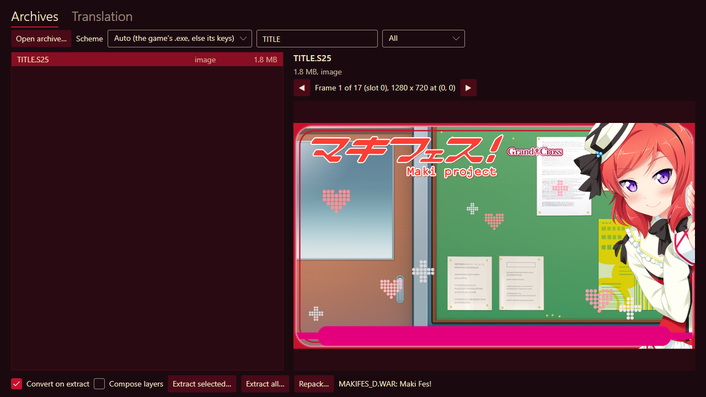
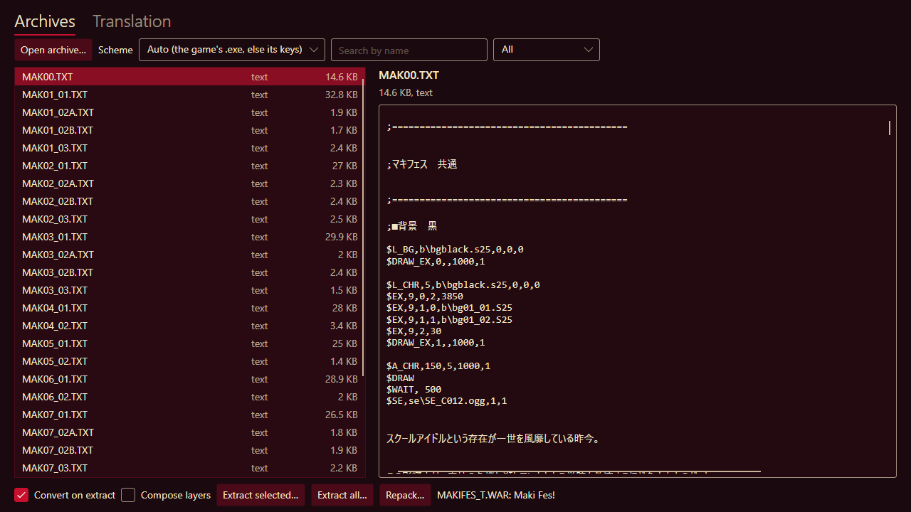
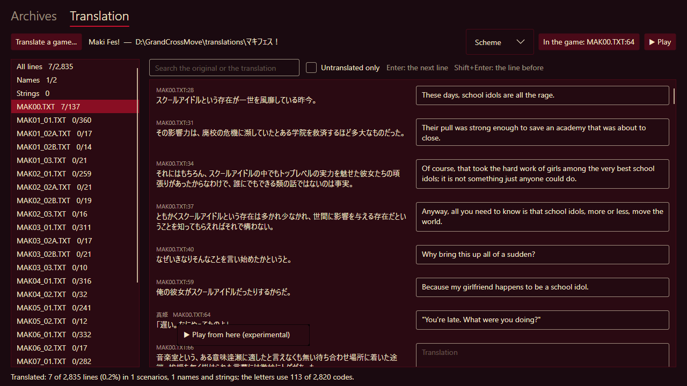

# OpenShiina Tools

OpenShiina Tools opens the archives of a ShiinaRio game: you can look through its pictures,
sounds and scripts, take them out as ordinary files, and pack edited files back in. It is also
where a game is translated. It knows every game the player knows, and changes nothing in the
game's own files.

The pictures on this page show **Maki Fes!** (GRAND†CROSS, 2014).


- [Getting started](#getting-started)
- [Archives: browse, preview and extract](#archives-browse-preview-and-extract)
- [Repack: put edited files back](#repack-put-edited-files-back)
- [Translation: translate a game](#translation-translate-a-game)
- [The translation's files](#the-translations-files)

## Getting started

1. Download `OpenShiinaTools-<version>-windows-x64.zip` (or `-linux-x64.tar.gz`) from the
   [Releases](https://github.com/kagaminehaku/OpenShiina/releases) page and extract it. Nothing
   has to be installed.
2. Run `OpenShiinaTools.exe` (Linux: `OpenShiinaTools`).

The window has two tabs: **Archives** and **Translation**. It uses the player's colours, the
theme chosen in OpenShiina's Settings → Appearance.

To open something straight away, give it on the command line:

```bash
OpenShiinaTools "D:\Games\Maki Fes!\MAKIFES_G.WAR"
```

An archive or an `.S25` picture opens in the Archives tab; a game folder opens in the
Translation tab.

The tools carry the player's engine: the Translation tab plays a game itself, so OpenShiina need
not be installed to try a translation.

## Archives: browse, preview and extract

### Open an archive

1. Click **Open archive…** and choose one of the game's `.WAR` files (or a single `.S25`
   picture).
2. Leave **Scheme** on *Auto*. The tools recognise the game by its `.exe` next to the archive,
   or else by trying the keys of the games they know. The line at the bottom says which game was
   found: `MAKIFES_G.WAR: Maki Fes!`.
3. If the files come out wrong (pictures that do not decode, scripts in garbled text), choose the
   game in the **Scheme** list yourself. The archive opens again with it.

A game keeps different things in different archives, each named after the game with a letter.
Maki Fes!, for example:

| Archive | What is in it |
|---|---|
| `MAKIFES_G.WAR` | Event pictures, character sprites, backgrounds |
| `MAKIFES_D.WAR` | The title screen, system pictures, button sounds |
| `MAKIFES_T.WAR` | The scenarios (the story's text, `.TXT`) |
| `MAKIFES_S.WAR` | The engine's scripts (`.SCN`) |
| `MAKIFES_V.WAR` | The voices |

### Find a file and preview it

- **Search by name** keeps the files whose name has what you type (`MK` above: Maki's sprites).
- The list next to it keeps one kind: **Images**, **Sounds** or **Scripts and text**.
- Click a file to see it on the right:
  - **Pictures** (S25, MI4, PNG, JPEG, BMP) are shown. An S25 picture can hold many frames, such
    as the parts of a title screen or a sprite's faces: **◀** and **▶** go through them, and the
    line between says which one is shown and where it goes on the screen.
  - **Sounds** (OGV, OGG, PAD, WAV) play with **▶ Play** and stop with **■ Stop**.
  - **Scripts and text** (the scenarios) show as text; anything else as bytes.
- Select several files with Ctrl or Shift.

| | |
|---|---|
|  |  |
| An S25 picture with 17 frames | A scenario: its text and the commands between |

### Extract

- **Extract selected…** saves the selected files into a folder you choose; **Extract all…** saves
  every file of the archive. Double-clicking a file saves that one.
- **Convert on extract** (on by default) turns the game's formats into ordinary ones:

  | In the archive | Saved as |
  |---|---|
  | `.S25`, `.MI4` pictures | `.png`; an S25 a file per frame (`TITLE@0000.png`, `TITLE@0001.png`, …) |
  | `.OGV` sound | `.ogg` |
  | `.PAD` sound | `.wav` |

  Turn it off to save the files exactly as they are stored. Do this for files you mean to edit
  and [repack](#repack-put-edited-files-back).
- **Compose layers**: event pictures and sprites are a base picture and layers on top (eyes,
  mouths, effects). With this on, each is saved as the whole pictures the story shows, the way
  its scenarios put the layers together. The scenarios are read from the archive of text next to
  this one (usually the game's `_T.WAR`); without it, the layers are saved as frames.

## Repack: put edited files back

**Repack…** makes a new archive with some of its files replaced by edited ones (WARC 1.7
archives, the newer games'):

1. Turn **Convert on extract** off and extract the files you want to change.
2. Edit them. Keep their names, and put them all in one folder.
3. Click **Repack…**, choose that folder, then where to save the new archive. The open archive
   itself cannot be written over: save the new one elsewhere.
4. The files of the folder that have the name of an entry are packed and encrypted like the
   game's; every other entry is copied as it is. Before the new archive is saved, each packed
   entry is read back and compared with its file. If one differs, nothing is saved.
5. Keep a copy of the game's original archive, then put the new one in its place.

Pictures cannot be made from PNG yet: there is no S25 encoder.

## Translation: translate a game


### Start a translation

1. Open the **Translation** tab and click **Translate a game…**. Choose the game's folder, the
   one with its `.exe` and `.WAR` files (or start the tools with that folder on the command
   line).
2. The first time, the tools read the game's scenarios and make the translation's tables in a
   `translation` folder inside the game folder. The line at the bottom says how many lines and
   names they found.
3. If the game is not recognised, open **Scheme** at the top, choose the game, and open the folder
   again.

The game's folder must be one you can write to (on Windows, not under `C:\Program Files`).

### Translate

- The list on the left has every scenario file with how much of it is translated (`7/137`).
  It also has **All lines** (every line at once), **Names** and **Strings**.
- On the right, each line of the original has a box for its translation. **Enter** goes to the
  next line, **Shift+Enter** to the line before.
- **Search the original or the translation** finds a word in either; **Untranslated only** hides
  what is done.
- Everything is saved a moment after you type: the line at the bottom says *Saved* and how far
  the translation is.

**Names** are the speakers' names. The scenarios keep the original names, because the game finds
its voices and name plates by them; the player draws the translated name.

**Strings** are texts the scripts draw themselves, such as choices and menus. **Add a string**
adds one: type the text exactly as the game shows it, then its translation. **✕** takes it out.

Keep the game's own symbols, such as `①`: the game draws a picture in their place (a heart in
the Bitch games).

### What the tab checks

After each save the tab checks what the player will make of the translation. The line at the
bottom says:

- how much is translated;
- how many of the 2,820 codes for letters it uses. The game reads its text as Japanese, so the
  player gives translated text codes the game leaves free: one for each different letter, pair
  of letters in a word, or space. Past 2,820, a letter shows as `?`. From nine tenths used, the
  line starts with ⚠.

A button at the bottom right shows only when something needs a look:

- *N lines do not fit*: translated lines of the tables that are not the game's (after a
  different version of the game, or an edit by hand). The button lists them.
- *The game differs in N lines: update…*: see below.

### Play

**▶ Play** saves, then plays the game in a window of the tools, as OpenShiina plays it: with the
player's settings (graphics, sound), and its saves are the player's saves of that game. Nothing is
built or copied; the game reads the tables as it plays.

- **Translate while it plays.** Each save reaches the game: the scenario playing keeps the text it
  was read with, the next scenario has the new one. To see a line again at once, load a save
  made before it.
- **▶ Play** again brings the game's window to the front. One game plays at a time.
- The game's window closes when the game ends, or with its **X** (the game may ask first, as it
  does in OpenShiina). Closing the tools closes it too.
- **Which line is this?** The game's window shows, in its top right corner, the id of the line
  it shows (`MAK00.TXT:64`), and the tools a button with it (*In the game: MAK00.TXT:64*). The
  button goes to that line in the table, its translation box ready to type in.


Translated lines may use any letters, Vietnamese included. They are drawn with their own widths
and wrapped at the window's edge by words.

### Play from here

To see a line in the game without playing up to it, right-click its original and choose
**▶ Play from here**. The game opens straight at that line, in a few seconds, the scene set as
the story sets it: no logos, no title (a game playing is closed first, when you say so).



How it gets there, and what that means:

- The game starts a new game at once, as if START were chosen on its title. Two of the games
  tried ask first: **Yuru Plus** its heroine (choose one, and it goes on to the line), and
  **Ao no Juuai** shows its title (start a new game).
- The first scenario of the new game is the line's scenario instead. What comes before the line
  in it is left out (the lines, speakers, voices, sounds and waits); its other commands still run
  (backgrounds, characters, music), quickly, as when skipping.
- What earlier scenarios and choices set is not there: a line that depends on a choice made
  before may show another picture than in the real game. A choice before the line, in the same
  scenario, stops on the way.
- The story goes on from the line as usual.
- **Saves are not kept**: the game saves and loads as usual while it runs (to see a line again
  after changing its translation, load a quick save made before it), but nothing is written, and
  the player's own saves stay as they were.

### After an update of the game

When the game's scenarios and the table differ (lines the table does not have, or lines whose
original changed), the button *The game differs in N lines: update…* shows at the bottom right.
It asks first, then brings the table up to date with the game. The translations of the lines
that did not change are kept; lines the game no longer has, or whose original changed, leave
the table with their translations, so keep a copy of the `translation` folder first if you need
them.

### Share a translation

Share the `translation` folder. To play it, put that folder into the game's folder, next to its
`.exe`, and start the game in OpenShiina. The game's own files stay as they are.

## The translation's files

The tables are plain text: UTF-8, a line each, tabs between the fields. They can also be filled
in a spreadsheet (Excel, LibreOffice, Google Sheets) or by a translation tool:

| File | What it holds |
|---|---|
| `text.tsv` | Every message line: its id (`MAK00.TXT:28`, the scenario and the line), the speaker, the original, the translation |
| `names.tsv` | The speakers' names: the original, the translation |
| `strings.tsv` | Texts the scripts draw themselves: the text exactly as the game shows it, the translation |

- Columns after the translation (notes, who translated a line) are kept.
- A field with a double quote in it is written the way spreadsheets write one: in double quotes,
  its own quotes doubled (`"""You're late."""` for `"You're late."`). The Translation tab and
  spreadsheets do this by themselves; mind it only when you edit a table in a text editor.
- A spreadsheet keeps a table it has open locked. While it is open, the tab cannot save
  (*Not saved: … is a table open in another program?*): close it there first.

The player also reads, in the same folder:

- a scenario file of its own (`.TXT`, UTF-8 **with a byte order mark**). It is found by the path
  the game reads it by (`translation\p\pro01_01.txt`) or by its name alone
  (`translation\PRO01_01.TXT`), and comes before `text.tsv` for that scenario. The Translation tab
  says when the folder has such files;
- `strings.txt`: a line each, the original, a tab, the translation (`#` starts a comment).

A text the scripts draw is replaced when the whole of it is one of the originals in the strings
or names.
